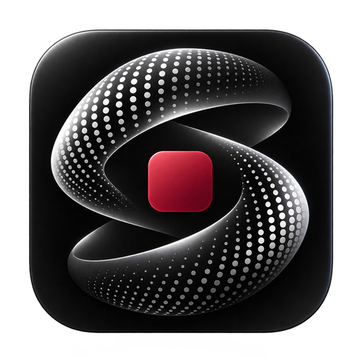
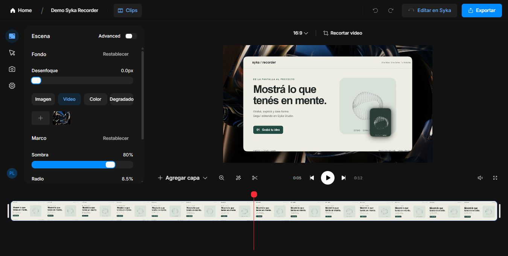
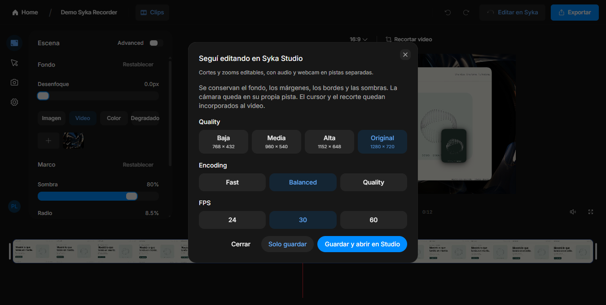
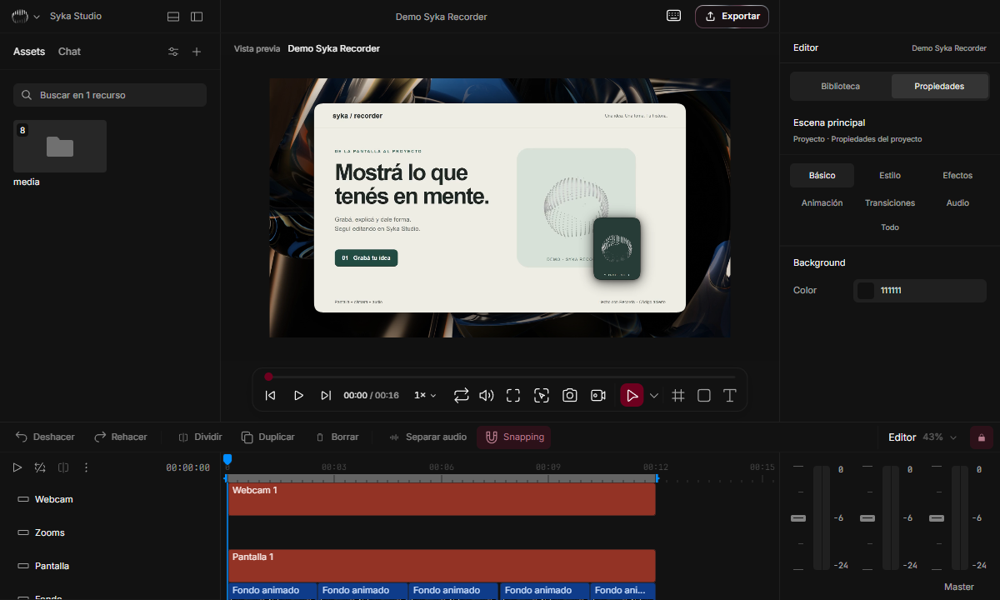
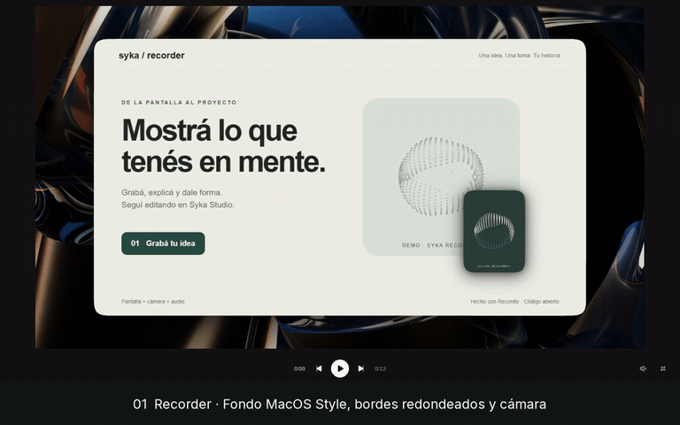

<p align="center">
  
</p>
<h1 align="center">Syka Recorder</h1>
<p align="center"><b>Grabá tu pantalla. Explicá tu idea. Seguí en Syka Studio.</b></p>
<p align="center">
  <a href="https://github.com/SikJa/syka-recorder/releases/latest/download/Syka-Recorder-x64-Setup.exe"></a>
</p>
<p align="center">
  <a href="LICENSE.md"></a>
  
  <a href="https://github.com/webadderallorg/Recordly"></a>
</p>
<p align="center"><b>Español</b> · <a href="README.en.md">English</a> · <a href="#instalación">Instalación</a> · <a href="#de-recorder-a-studio">Editar en Studio</a> · <a href="CREDITS.md">Créditos</a></p>

**Syka Recorder es un fork independiente de [Recordly](https://github.com/webadderallorg/Recordly), creado por webadderall y sus colaboradores.** Sobre su grabadora y editor, Syka agrega su identidad visual, anotaciones durante la grabación y un puente a proyectos editables de [Syka Studio](https://github.com/SikJa/syka-studio). Conservamos el código abierto, el historial y las atribuciones del proyecto original.

<p align="center"></p>
<p align="center"><sub>Captura de la aplicación. El contenido y la cámara son material de demostración.</sub></p>

## De una toma a un proyecto

| Grabá | Explicá | Editá |
| --- | --- | --- |
| Pantalla, ventana o región; webcam, micrófono y audio del sistema. | Lápiz, línea, flecha, formas, resaltador, texto y difuminado. | Cortes, velocidad, zooms, cursor, fondos, bordes y sombras. |
| Barra flotante que podés minimizar y mover. | Un panel que se cierra sin desactivar el dibujo. Deshacer con Ctrl+Z. | Vista en pantalla completa y exportación MP4 o proyecto de Studio. |

Sin cuenta de Recordly. Grabaciones y proyectos locales. Podés usar Recorder solo; Studio es opcional para continuar la edición.

## De Recorder a Studio

1. Terminá la grabación y ajustá el fondo, el encuadre y la cámara en Recorder.
2. Tocá **Editar en Syka → Guardar y abrir en Studio**.
3. Elegí una carpeta. Recorder guarda el proyecto y lo abre en tu instalación de Studio.
4. Seguí editando: los medios, cortes, fondo, marcos, sombras, cámara y pistas de audio conservan su estructura editable.

<p align="center"></p>
<p align="center"></p>

<p align="center"><a href="https://github.com/SikJa/syka-recorder/releases/latest/download/Syka-Recorder-demo.mp4"></a></p>

**[Ver la demo completa · 37 segundos](https://github.com/SikJa/syka-recorder/releases/latest/download/Syka-Recorder-demo.mp4)** · [Qué se probó](docs/demo.md) · [Cómo funciona la transferencia](docs/studio-transfer.md)

Si no tenés Studio, aparece un aviso para **descargarlo**, **buscar una instalación existente** o **seguir después**. El proyecto ya queda guardado. Recorder encuentra las instalaciones habituales y las carpetas de versión de Studio; una actualización normal de Studio no depende de rutas de la computadora del desarrollador.

Compartí **la carpeta completa**, no sólo `manifest.json`. Los medios del proyecto nativo usan rutas relativas. No se copian cuentas ni perfiles. La compatibilidad se comprueba contra la versión de Studio disponible: cambios futuros de su formato o CLI pueden necesitar una actualización de Recorder.

## Instalación

**Windows x64.** Descargá el instalador con el botón de arriba, ejecutalo y abrí Syka Recorder. No necesitás Node.js ni herramientas de desarrollo. El instalador actual no tiene firma Authenticode; Windows puede mostrar un aviso de editor desconocido. Los hashes están en la release.

El código conserva soporte heredado de otras plataformas, pero esta distribución y la integración con Studio se validan en Windows. No ofrecemos todavía instaladores certificados de macOS/Linux.

### Actualizaciones

Recorder consulta las releases estables de **este repositorio** al iniciar y periódicamente. Cuando hay una versión nueva, muestra un aviso. Vos elegís descargarla y reiniciar; no instala al cerrar ni interrumpe una grabación o un proyecto sin guardar. Publicar sólo código no actualiza la aplicación: cada release necesita el instalador, su `.blockmap` y `latest.yml` generados juntos.

## Algunas cosas que conviene saber

- Los dibujos quedan incorporados al video. Ctrl+Z quita la marca desde ese momento; no borra cuadros ya grabados.
- Los atajos de dibujo necesitan foco en Recorder. El difuminado trabaja con una muestra estática.
- Cursor y dibujos grabados son parte del video transferido. La webcam reactiva al zoom se convierte en una capa fija; el diálogo explica las diferencias.
- La versión inicial se probó localmente. Una compilación exitosa no reemplaza las pruebas en distintos equipos, cámaras y dispositivos de audio.

## Desarrollo y contribuciones

Node.js 22+, npm, Visual Studio Build Tools y Windows SDK para compilar los auxiliares de captura.

```sh
npm ci
npm run dev
```

```sh
npm run typecheck
npm test
npm run build:win -- --publish never
```

El instalador queda en `release/`. [Contribuir](CONTRIBUTING.md) · [Publicar una actualización](docs/releases.md) · [Reportar un problema](https://github.com/SikJa/syka-recorder/issues)

## Código abierto, origen y créditos

El trabajo de **Recordly, webadderall y sus colaboradores** es la base de esta aplicación. No lo presentamos como un motor desarrollado desde cero. Las herramientas de dibujo están adaptadas de **[Whispera](https://github.com/SikJa/Whispera)**, bajo MIT. **Syka Studio** conserva su repositorio y licencia independientes; las adaptaciones de archivos MPL mantienen sus avisos. El orbe usa **thinking-orbs**, los iconos son de **Phosphor**, la tipografía es **Inter** y el procesamiento de medios utiliza **FFmpeg/ffprobe**.

El código cubierto y nuestras modificaciones se publican bajo **[AGPL-3.0](LICENSE.md)**. Los componentes de terceros conservan sus propias licencias. Cada release enlaza su código fuente y el instalador incluye los avisos.

**[Créditos completos](CREDITS.md)** · **[Avisos de terceros](THIRD_PARTY_NOTICES.md)** · [Documentación original de Recordly](docs/upstream/README-Recordly.md)

Syka Recorder es un proyecto independiente: los créditos no implican afiliación ni aval de los autores originales.
